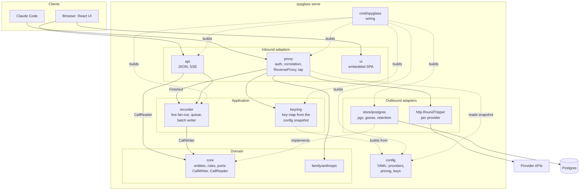
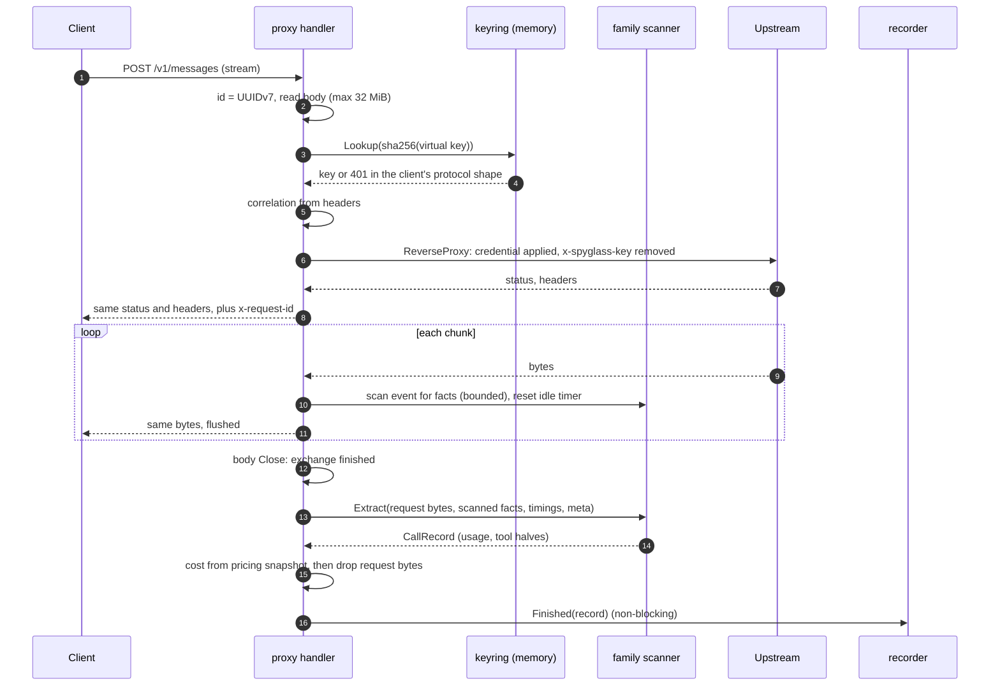
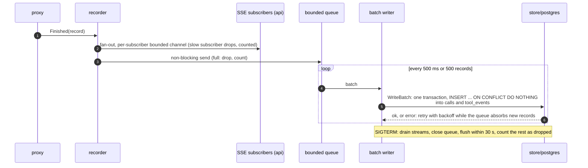

# Backend architecture (Go)

Part of the [architecture set](README.md). v1 is an observe-only logging proxy for the Anthropic family: it forwards, records and shows calls. Gateway features (fallback, budgets, rate limits, alerts, OTel) are in [Later versions](#later-versions). Storage sits behind two ports; see [Storage ports and adapters](#storage-ports-and-adapters). Upstream credentials and Claude subscription routing are in [upstream-connection.md](upstream-connection.md). The UI that consumes the admin API is in [frontend.md](frontend.md). How the binary is deployed is in [deployment.md](deployment.md).

## Shape

One Go module, one static binary, `spyglass`, with these subcommands:

| Subcommand | Purpose |
|---|---|
| `serve` | Applies the embedded migrations, then runs the data plane, the admin plane, the recorder and the retention job |
| `keygen --name <name>` | Generates a virtual key, prints the plaintext once and the config entry with its SHA-256. Touches no config file and no database; see [Auth](#auth-virtual-keys) |
| `version` | Prints the build version |
| `describe`, `config`, `sessions list\|show`, `calls list\|show`, and no argument (the home view) | The agent-facing CLI ([ADR 0055](../adrs/0055-agent-facing-cli-axi-toon-output.md), [cli.md](cli.md)). Read-only `GET` clients of the admin API, `SPYGLASS_ADMIN_URL` (default `http://127.0.0.1:9090`), TOON output on stdout. They do not read the config file and never touch the database |

**Storage model.** The proxy never stores request or response bodies. The tap reads each exchange in memory, the extractor keeps a small set of facts (who, provider, tokens, cost, timings, outcome, tool-call metadata), and the recorder inserts them as append-only rows through the `CallWriter` store port, implemented in v1 by the `store/postgres` adapter. There is no capture journal and no body table. Consequences: no search over prompt or response text, call detail shows numbers and tool names but not content, and a wrong parsing rule cannot be recomputed for past rows; a fix applies to new calls only. This resolves decisions D1 and D2 ([README](README.md#resolved-decisions)).

**Write facts, derive views.** The database receives only inserts. Tool-call pairing, sessions, agent trees and statistics are computed by `CallReader` when asked, not maintained when written. This is what keeps the write path and the schema small.

The binary has two listeners, so the data plane and the admin plane can be exposed separately (see [Listener and router](#listener-and-router)):

| Listener | Default address | Serves |
|---|---|---|
| Data plane | `:8080` | `/v1/*` Anthropic Messages endpoints, `HEAD /api/hello`, `/healthz`, `/readyz` |
| Admin plane | `127.0.0.1:9090` | `/admin/*` JSON API and SSE, `/ui/*` embedded React SPA, `/metrics`, `/healthz`, `/readyz` |

**The admin plane has no sign-in in v1.** It binds to a loopback address by default, and `serve` refuses to start if `listen.admin` is not a loopback address (`127.0.0.1`, `::1` or `localhost`). Anyone who can reach the loopback interface of the host can read the admin API and the UI, so the host must be trusted. Admin sign-in is a later item ([Later versions](#later-versions)). Virtual-key auth on the data plane is unchanged.

## Component diagram



Everything between the Go components and Postgres goes through the store ports. Only `cmd/spyglass` wiring imports the `store/postgres` adapter (see [Storage ports and adapters](#storage-ports-and-adapters)).

Two properties hold for every arrow out of the data plane:

- **The hot path never waits on storage.** Nothing between the client and the upstream calls a store port. Auth reads the in-memory key map and routing reads the config snapshot. The key map is built from that snapshot, so a key change takes effect on `SIGHUP`.
- **Logging never fails a request.** A full queue drops the call record and increments a counter. A batch write that fails for a transient reason is retried, logged and counted. A record the store will never accept is isolated, dropped and counted, so it cannot block the writer. A store outage (for example Postgres down) fills the queue, and records past its capacity are dropped and counted.

## Layers and the dependency rule

Clean architecture with small rings. `core` at the centre holds entities, pure rules and the port interfaces. Adapters sit at the edge. Every import points inward. `cmd` is the only place that knows concrete types.

| Ring | Packages | May import |
|---|---|---|
| Domain | `core` | Standard library only |
| Protocol knowledge (pure) | `family/anthropic` | `core`, `gjson` |
| Application (use cases) | `recorder`, `keyring` | `core` |
| Adapters, inbound | `proxy` (data plane), `api` (admin plane), `ui` | `core`, application packages, `family/*` (`proxy` only) |
| Adapters, outbound | `store/postgres`; upstream is `http.RoundTripper` | `core`, drivers |
| Configuration | `config` | `core`, `yaml` |
| Wiring | `cmd/spyglass` | everything |

**Upstream port.** The standard library already has one: `http.RoundTripper`. `proxy` takes a `RoundTripper` per provider; tests pass a fake or an `httptest.Server`. A custom `Upstream` interface would wrap `RoundTripper` in a narrower shape and lose `ReverseProxy`'s streaming, flushing and cancellation behaviour (see [Proxy passthrough and streaming](#proxy-passthrough-and-streaming)). There is no custom upstream port.

**Read side.** There is no query service layer. The read side has no business logic beyond mapping parameters, so `api` handlers map HTTP parameters to `core` filter types and call `CallReader` directly.

## Components

### Listener and router

- `net/http` server with the standard `ServeMux` and method patterns (Go 1.22 and later). No web framework (gap review B10, approaches report section 8).
- Server timeouts: set `ReadHeaderTimeout` and `IdleTimeout`. **Do not set a global `WriteTimeout`**: it cuts long SSE streams. The approaches report measured this (section 6, finding 4). Each streaming request clears its own write deadline with `http.NewResponseController(w).SetWriteDeadline(time.Time{})`.
- **One request-size limit:** `server.max_request_bytes`, default 32 MiB (gap review R15), enforced with `http.MaxBytesReader`. A larger body is rejected before the tap sees it. There is no second, extraction-side request limit. `extraction_partial` applies to the response side only (see [Tap](#tap)).
- Every response carries `x-request-id`, a UUIDv7 that is also the primary id of the call. A client-supplied `x-request-id` is kept as `client_request_id`, never reused as the id (gap review R17).
- The handler runs these steps as plain function calls: recover, request id, access log (`log/slog`, with header redaction in one place), auth, correlation.
- Graceful shutdown on SIGTERM: stop accepting connections, wait for in-flight streams up to a drain deadline (default 10 minutes, gap review R14), close the queue, and let the batch writer drain it into the store within a flush deadline (default 30 seconds). Records still queued after the deadline are counted as dropped and their number is logged.

### Proxy handler (`proxy` package)

The hot path is one flow, so it is one package with one file per concern: auth, correlation, body read, `ReverseProxy` setup, tap, idle watchdog, drain. It defines small interfaces for what it needs (`KeyLookup`, `Recorder`) and imports no `store` package.

#### Auth (virtual keys)

- **Virtual keys** look like `lp_<base62 of 32 random bytes>`. They live in the `keys` section of the config file, one entry per key: a `name`, the `sha256` (hex) of the key, and an optional `disabled` flag. The file never holds the plaintext (gap review R1). Keys are 256 bits of randomness, so a plain hash cannot be brute-forced and no server pepper is needed.
- **Key names** are unique and stay stable: the call record stores the name, so renaming a key splits its history. `fm:<task-id>` is a valid name. A name is the only per-key identifier; there is no display prefix.
- **Generating a key** happens outside the proxy. `spyglass keygen --name <name>` draws 32 bytes from the system random source, prints the plaintext key once, and prints the config entry to paste (`name` and `sha256`). The proxy keeps nothing. Without the helper, `openssl rand -hex 32` behind an `lp_` prefix gives an equally strong key, and `sha256sum` gives its hash; the proxy treats the presented key as an opaque string and hashes it. [deployment.md](deployment.md#secrets) has the exact commands.
- **Changing keys** is a config edit plus `SIGHUP`. Add: append an entry. Revoke: set `disabled: true` or delete the entry. Rotate: add the new entry, switch the client, then disable the old one. There is no key API.
- **Where the key is read from.** Each provider has one fixed `auth_mode`. For a `proxy_key` provider (the default) the client sends its virtual key as its API credential: `Authorization: Bearer lp_…` or `x-api-key: lp_…`. For a `client_passthrough` provider the client's own credential occupies `Authorization`, so the virtual key travels in a separate `x-spyglass-key` header (or its deprecated 0.1.0 name `x-llm-proxy-key`, read only when `x-spyglass-key` is absent; ADR 0054). [upstream-connection.md](upstream-connection.md#credential-modes) explains both modes.
- **One header check.** A presented `lp_` virtual key is never forwarded upstream. A request that carries a credential in the wrong place for the provider's mode is rejected with `401`: for a `client_passthrough` provider, an `lp_` value in `Authorization` or `x-api-key`; for a `proxy_key` provider, an `x-spyglass-key` or `x-llm-proxy-key` header.
- **Lookup** is an in-memory map from SHA-256 to key record, owned by `keyring`. `keyring` builds it from the keys of a config snapshot, and the map travels with that snapshot: `SIGHUP` builds a new snapshot and swaps it atomically, and a request in flight keeps the map it started with. The handler hashes the presented key and looks the hash up. The config loader rejects a snapshot with a duplicate name, a duplicate hash or a malformed hash, and the proxy keeps the previous snapshot and logs the error. Nothing about keys touches the store.
- **Checks:** the key exists and is not disabled. A failure returns a protocol-correct Anthropic error body with a stable `type` per error class (gap review R3). Expiry, request-rate and concurrency limits and budgets are deferred ([Later versions](#later-versions)).
- **Admin plane** has no auth in v1. The admin listener is loopback-only and `serve` refuses to start otherwise (see [Shape](#shape)). Admin sign-in is a later item ([Later versions](#later-versions)).

#### Correlation

The correlation step reads harness headers into the call record. It never parses the body. One table-driven function does it.

| Field | Source |
|---|---|
| `session_key` | `x-claude-code-session-id`; a call without it has no session (`session_key` is null) |
| `agent_id`, `parent_agent_id` | `x-claude-code-agent-id`, `x-claude-code-parent-agent-id` |
| `agent_type` | `x-claude-code-agent-type` (hint header) |
| `prompt_id` | `x-claude-code-prompt-id` (hint header) |
| `request_class` | `x-claude-code-request-class`: `main`, `subagent`, `workflow`, `compaction`, `auxiliary` (hint header) |
| `compaction`, `context_compacted` | `x-claude-code-compaction`, `x-claude-code-context-compacted` (hint headers). Both are stored as booleans; the UI compaction marker uses `context_compacted` |
| `prev_tool_durations` | `x-claude-code-prev-tool-durations`, raw value, stored on the call row (hint header) |
| `trace_id` | W3C `traceparent` |
| `client`, `client_raw` | `User-Agent` normalized to its product token (`claude-cli/2.1.290` becomes `claude-cli`), raw value kept (gap review R17) |

- The Claude Code header names and semantics come from Anthropic's [gateway compatibility guide](https://code.claude.com/docs/en/llm-gateway-protocol). The session and agent IDs are always sent. The rows marked "hint header" arrive behind a custom base URL only when the client sets `CLAUDE_CODE_GATEWAY_HINT_HEADERS=1`. Firstmate crewmates set it (resolved decision D5, [ADR 0042](../adrs/0042-claude-code-hint-headers-for-crewmates.md)).
- Correlation headers are forwarded upstream unchanged, so the proxy stays transparent.
- **No session derivation in v1.** Claude Code always sends `x-claude-code-session-id`. A call without it has no session: `session_key` is null, and the call shows in the call log but in no session. The extractor hashes no tools, system prompt or message.
- Session headers of other harnesses (Codex, OpenCode) are a v2 item ([Later versions](#later-versions)).

#### Forwarding and the config snapshot

- v1 has one configured Anthropic provider. A request is forwarded exactly as sent: the body bytes and the `model` value are never rewritten. The call record keeps the model the client asked for.
- The config snapshot is read once per request, so a `SIGHUP` reload never changes a request in flight (gap review R2).
- In `client_passthrough` mode the proxy allows only the provider the client's credential belongs to; see [upstream-connection.md](upstream-connection.md#what-the-proxy-must-and-must-not-do-in-passthrough-mode).
- **One body read.** The handler reads the whole request body once, bounded by `MaxBytesReader`, before forwarding. That byte slice is forwarded to the upstream and handed to the extractor after the exchange ends. There is no tee and no second buffer.

#### Proxy passthrough and streaming

Built on `net/http/httputil.ReverseProxy`. The approaches report verified the relevant behaviour with an experiment (section 6): immediate flushing of `text/event-stream`, cancellation propagation, body closing on client abort, and no measurable added latency.

- **`Rewrite`** sets the upstream URL from the configured provider, applies the credential mode (replace the client credential with the provider key, or pass it through), removes `x-spyglass-key` and `x-llm-proxy-key` and sets `Accept-Encoding: identity`, so the upstream sends an uncompressed body that the tap can scan ([ADR 0050](../adrs/0050-upstream-identity-encoding.md)). All other headers and body bytes are forwarded unchanged. `anthropic-version`, `anthropic-beta` and every other `anthropic-*` header are forwarded as open lists, as Anthropic's guide requires.
- **`Transport`** is a plain `http.Transport` with default pool and HTTP/2 settings, one per provider. v1 has no retry and no fallback. An upstream 4xx or 5xx reaches the client unchanged, with `x-request-id` added, and the client applies its own retry rules. Claude Code's retry logic matches on the upstream's error wording, so error bodies are never wrapped (gap review R3).
- **Response headers** pass through unchanged, in particular `content-type`, `retry-after`, `x-should-retry` and `anthropic-ratelimit-unified-*`. The upstream's own request id header is stored as `upstream_request_id` on the call row.
- **Upstream timeouts:** a `net.Dialer` timeout, `Transport.ResponseHeaderTimeout` for time to headers, and an idle-between-chunks watchdog in the tap (provider setting `idle_timeout`). SSE `ping` events are never stripped: during long thinking pauses they are the only bytes on the stream.
- **Client abort:** the upstream request uses the client's context, so an abort cancels upstream (gap review R4). The call is still logged, with the facts extracted so far, `error_class = client_abort` and `usage_estimated = true`.
- **Local endpoints:** `HEAD /api/hello` is answered locally. `GET /v1/models` and `POST /v1/messages/count_tokens` are forwarded upstream.

#### Tap

The tap reads the stream in memory, extracts facts and discards the bytes. No body is written to disk or to the store.

- `ModifyResponse` wraps the upstream response body in a tap. `Read` passes each chunk to an incremental scanner and forwards it unchanged, then resets the idle watchdog. For SSE it splits events on blank lines and keeps only the facts below. For a non-streaming JSON response it buffers up to the size bound, then parses once.
- The request side needs no tap: the body is already in memory from the single read above. The extractor reads the request facts from that slice, and the slice is released as soon as extraction ends.
- Response buffers are bounded (1 MiB for one SSE event, a fixed bound for a non-streaming body). Past a bound the tap stops reading that part, keeps forwarding, and sets `extraction_partial = true` on the record. Fields it could not read stay null.
- An upstream that compresses despite `Accept-Encoding: identity` gets the same treatment: a body with a non-identity `Content-Encoding` passes through unscanned and the record gets `extraction_partial = true` ([ADR 0050](../adrs/0050-upstream-identity-encoding.md)).
- `Close` is the "exchange finished" hook. `ReverseProxy` closes the upstream body on success, on upstream error and on client abort, so the hook is reliable.
- The tap measured 54 µs in total for a whole 5-event stream in the approaches report's experiment. That figure covered copying only; the cost of incremental scanning is a phase-1 measurement.

### Extractor

The only code that understands provider formats, in package `family/anthropic`. It is a set of pure functions, golden-tested against recorded SSE fixtures, with no I/O and no `net/http` server types. The proxy calls it after `Close`, off the hot path, and it turns one exchange into one **call record**. A second family is a second package under `family/` ([Later versions](#later-versions)).

A call record holds:

- **Who:** key name, client, session key (null without the header), agent and parent agent, agent type, prompt id, and the compaction flags `compaction` and `context_compacted` (all from headers, see [Correlation](#correlation)).
- **What ran:** provider, model (as the client sent it), `upstream_request_id`, and `auth_mode`, the credential mode actually used for the request (`proxy_key` or `client_passthrough`, the config names). There is one attempt per call in v1.
- **Usage and cost:** tokens normalized into disjoint columns (input, cache read, cache write, output, reasoning), the raw provider usage JSON (gap review B6), and cost from the versioned pricing in the config snapshot, with the pricing version. `pricing_version` is the `from` date of the matched pricing entry (for example `2026-10-01`); there is no separate pricing id. `usage_raw` is the only thing that lets a normalization fix be applied to old rows.
- **Timings:** time to first byte, TTFT, total duration, and the end timestamp.
- **Outcome:** HTTP status, `error_class`, the provider's error `type` (for example `overloaded_error`), stop reason, `streamed`, `usage_estimated`, `extraction_partial`. The provider's error message text is not kept.
- **Tool halves:** for each `tool_use` block in the response: the provider call id, tool name and argument size in bytes. For each `tool_result` block in the trailing run of consecutive user messages of the request: the call id it answers, `is_error` and the result size in bytes; earlier results were recorded by the calls that first carried them. Server tool result blocks in the response (such as `web_search_tool_result`) give the same fields with `source = server`. Tool ids and names are kept only as JSON strings of at most 256 bytes. Argument text and result text are read to measure them and are not kept. No snippet, no prompt text and no header value other than the correlation fields above is stored; credentials are never read into the record. In `client_passthrough` mode the client's OAuth token is never written anywhere; see [upstream-connection.md](upstream-connection.md#what-the-proxy-must-and-must-not-do-in-passthrough-mode).

Resolved decisions D11 to D13 ([README](README.md#resolved-decisions)) keep the strict reading: no short tool argument or error snippets (D11, [ADR 0043](../adrs/0043-short-tool-snippets.md)), no provider error message text (D12, [ADR 0044](../adrs/0044-provider-error-message-text.md)), and no per-key body capture switch (D13, [ADR 0045](../adrs/0045-opt-in-per-key-body-capture.md)).

After building the record, the proxy computes cost from the pricing snapshot, drops the request bytes, and sends `Finished(record)` to the recorder.

### Error classes and error bodies

`error_class` is a closed vocabulary ([ADR 0007](../adrs/0007-anthropic-error-classes-and-error-bodies.md)). `core.ClassifyOutcome(status, kind)` maps one outcome to exactly one class. A failure the proxy saw itself (client abort, idle timeout, unreachable upstream, rejected key, internal error) decides alone; otherwise the HTTP status decides. A status below 400 has no class.

| `error_class` | Set when | Proxy-generated response | Anthropic `type` |
|---|---|---|---|
| `rate_limited` | Upstream 429 | none (v1 enforces no rate limit) | none |
| `upstream_5xx` | Upstream 5xx (including 529), or upstream unreachable | 502 | `api_error` |
| `timeout` | Upstream 408 or 504, dial or header timeout, idle-between-chunks watchdog | 504 before response headers; none after headers, because the stream just ends | `timeout_error` |
| `auth` | Upstream 401 or 403, or a missing, invalid or disabled virtual key | 401 | `authentication_error` |
| `client_abort` | The client went away before the call finished | none (nobody is listening) | none |
| `invalid_request` | Any other upstream 4xx, or a request the proxy rejects | 400 malformed, 413 oversize body | `invalid_request_error`, `request_too_large` |
| `internal` | A failure inside the proxy | 500 | `api_error` |

The idle watchdog can fire before or after the response headers. Before headers it watches only a streaming request (`"stream": true`), whose headers come at once, and the proxy builds the 504. A non-streaming request sends no header until the model has finished, so `Transport.ResponseHeaderTimeout` alone bounds that wait. After headers the status line has gone to the client, so the proxy ends the stream and the record gets `error_class = timeout`. The `type` column applies to bodies the proxy builds in `family/anthropic` (pure functions returning status, headers and body). Upstream error bodies are never rebuilt: they reach the client unchanged with `x-request-id` added, and the provider's own `type` (for example `overloaded_error`) is stored as `error_type`. The body shape is `{"type":"error","error":{"type":"<type>","message":"<text>"},"request_id":"<call id>"}`.

A path or method the data plane does not serve gets a proxy-generated 404 with `type` `not_found_error`. It is not a call, so it has no `error_class` and no call record.

### Recorder (`recorder` package)

The one "finished call" use case. It receives `Finished` events from the proxy and does three things, none of them blocking:

1. **Live fan-out.** Each subscriber of the live tail (the SSE handler in `api`) gets a bounded channel. A slow subscriber loses events, and the loss is counted (`spyglass_live_events_dropped_total`).
2. **Bounded queue.** `Finished` goes to the queue with a non-blocking `select`. When the queue is full the recorder drops the record and increments `spyglass_calls_dropped_total` with a `reason` label (`queue_full`, `shutdown`, or `unwritable` for a record the store rejects; see Failure below).
3. **Batch writer.** One goroutine drains the queue and hands batches to `CallWriter.WriteBatch`. There is no intermediate store: the queue is the only buffer. The recorder contains no SQL.

Writer details:

- **Batching:** a batch closes at 500 records or 500 ms, whichever comes first. These are constants in code. Only `queue_capacity` (default 10,000) is configurable until measurement says otherwise.
- **Write path in `store/postgres`:** one transaction, a multi-row `INSERT … ON CONFLICT DO NOTHING` into `calls` and `tool_events`. At 0.14 to 0.58 calls per second on average this is ample. The call id is a UUIDv7 assigned at request start, so a retried batch inserts nothing twice (gap review B5). The port contract is "idempotent on call id and atomic per batch"; the SQL is the adapter's choice.
- **Failure (ADR 0051):** every failed `WriteBatch` call is counted (`spyglass_writer_errors_total`). The store adapter classifies the error; the recorder never inspects a driver error.
  - A **transient** error (connection, timeout, outage, and every error the adapter does not recognize) retries the same batch with backoff. While the store is down the queue fills; the recorder then drops and counts new records as `queue_full`. The data plane never notices.
  - An error that matches `core.ErrUnwritable` means the batch holds a record the store will never accept. Postgres classes 22 (data exception), 23 (integrity constraint violation) and 54 (program limit exceeded), and a value `pgx` cannot encode, are unwritable. The recorder splits the batch in halves until each rejected record stands alone. The other records commit. When the split is done, each rejected record is dropped, counted as `spyglass_calls_dropped_total{reason="unwritable"}` and logged with its call id, key name, SQLSTATE and constraint or column, never a body field. A rate above zero on that reason is the alert: it points to a cause the write-path sanitizing (ADR 0017) does not cover.
  - **Systematic failure:** when every record of a batch of at least 8 records (`recorder.SystematicMinRecords`) is unwritable, the cause is taken as a bug, not as bad records. The recorder drops nothing, keeps the batch and retries it with backoff, and `spyglass_writer_systematic_failure` is 1 until a write commits. A value of 1 is the alert: the writer is blocked and the queue fills. Smaller all-fail batches are dropped per record.
  - A crash loses the queue contents, at most `queue_capacity` records; this is the accepted cost of having no durable buffer. On a shutdown abort, every record of the batch in hand that is not yet stored or dropped counts as `reason="shutdown"`, with the queue.
- **Shutdown:** on SIGTERM, after in-flight streams finish or the drain deadline passes, the queue is closed and the writer flushes what remains within 30 seconds, then exits. See [Listener and router](#listener-and-router).
- **Appends only.** The writer does no joins, no read-modify-write and no session or agent updates. It also does not publish to the live tail after commit: the fan-out happens at `Finished`, before the commit, as an in-process event.

### Tool calls, sessions and agents at read time

A proxy never sees a tool run. It sees the model request the tool in response N, and the client return the result in request N+1, linked by the tool-call id (approaches report section 3). v1 stores each half as its own append-only row and pairs them when read.

- A `tool_use` half is a `tool_events` row with `kind = use`: tool name, provider call id, argument size, the carrying call. A `tool_result` half is a row with `kind = result`: provider call id, `is_error`, result size.
- **Pairing:** `CallReader` joins a use to the result with the same `tool_call_id`. The window for results reaches up to 24 hours past the query's `To` bound, so a use near the end of the range still finds its result. Provider tool-call ids (`toolu_…`) are random and unique on their own, so the join does not need the session key, and a session split across replicas cannot break it. The join is a query in the Postgres adapter, not a view, because its bounds depend on the query (ADR 0020).
- **Duration:** the `prev_tool_durations` header value on the resolving call when present (`duration_source = header`), otherwise the gap between the use row and the result row (`duration_source = estimated`). Parallel tool calls each get their own reported time.
- **Unmatched halves** are derived: a use with no result after 1 hour is `use_only`; a result with no use is `result_only`. The 1 hour and the 24 hours are the only two constants. Nothing sets these at write time, so there is no idle-close job.
- **Why this is safe:** every write is a plain insert, so a retried batch, out-of-order arrival, or two replicas writing the halves cannot corrupt anything.
- **Sessions** are `GROUP BY session_key` over `calls` in the time range. Calls with a null `session_key` belong to no session. The **agent tree** is the distinct `(agent_id, parent_agent_id, agent_type)` set of a session. There are no `sessions` or `agents` tables.
- **Server-side tools** (Anthropic web search, code execution) appear complete inside one response and are recorded with `source = server`: the use half and the result half (id, `is_error`, size), both timed at response end.
- The inferred link from a sub-agent to the `Task` tool call that spawned it is deferred; a sub-agent nests under its parent agent, from headers. `source = mcp` arrives with the MCP gateway, a later item ([Later versions](#storage-and-scale)).

### Admin and query API

Served on the admin listener under `/admin/`, implemented by the `api` package. The handlers read through the `CallReader` port and never see SQL. JSON over HTTP, described by an OpenAPI 3.1 document at `/admin/openapi.json`, from which the UI generates its TypeScript types. `api` owns the wire format, including the cursor encoding; the port takes typed `core.Cursor` values.

| Method and path | Purpose | Gap |
|---|---|---|
| `GET /admin/calls` | Call log: filters, keyset cursor, `limit` | G1, G8, G9 |
| `GET /admin/calls/{id}` | One call's metadata and tool calls. Numbers and names only, no content | G4 |
| `GET /admin/sessions` | Session list with the same filters and cursor, computed from call rows | G3 |
| `GET /admin/sessions/{key}` | Summary, prompts, agents and calls (metadata only) | G2, G3 |
| `GET /admin/tool-calls` | Tool-call explorer list; `?session=` filters to one session | G6 |
| `GET /admin/tool-calls/summary` | Per-tool count, error rate, p50 and p95 duration, total time, split by agent type | G6 |
| `GET /admin/usage` | Time series computed from raw rows, `group_by` and `grain` | G7 |
| `GET /admin/usage/prompts` | Cost per prompt over every matching call, most costly first, with `limit` ([ADR 0057](../adrs/0057-cost-per-prompt-endpoint.md)) | |
| `GET /admin/stream` | SSE live tail of finished calls, with the call-log filters | G13 |
| `GET /admin/config` | Read-only view of providers and pricing from the config file, and the key names with their `disabled` flag (never a hash) | |

List conventions:

- **Filters** are query parameters, repeated for multiple values: `model=a&model=b`, `status=429`, `latency_ms_gte=60000`, `tool=Bash&tool_error=true`. The full filter list is the one in UI report 5.1, without its text-search filters (withdrawn) and without TTFT, tokens and cache hit, which the v1 call-log filter menu drops.
- **Keyset pagination, forward only,** on `(ts, id)`: the port takes a `Cursor{TS, ID}` and a limit, and orders by `ts DESC, id DESC`. The `store/postgres` adapter runs `WHERE (ts, id) < ($ts, $id) ORDER BY ts DESC, id DESC LIMIT $n`. The cursor is opaque on the wire (base64 of `ts` and `id`, plus an index for tool calls, which can share both; encoded in `api` only). Every list response carries `next_cursor`; only the call list also carries `count` and `count_capped`. There is no backward cursor and no offset pagination (UI report 6.3); to see newer calls the UI reloads page one, and the live tail covers the rest.
- **Capped exact counts.** Only the call list carries `count` and `count_capped`; the session and tool-call lists carry no count. The count is exact up to 10,001 rows; above that the UI shows "10,000+". A 24-hour window at the stated volume holds at most about 50,000 rows.
- Every list query is bounded by a time range (default last 24 hours).

There is no endpoint that returns prompt, response or tool content, because none is stored.

### Live tail

- The proxy publishes `Finished` events to the recorder, which fans them out in process. There is no `Started` event: the live tail shows finished calls only.
- `GET /admin/stream` subscribes to the recorder, applies `core.CallFilter.Match` to each event, and writes SSE. Each event has an `id` (the call's UUIDv7) for the UI's own de-duplication.
- **No `Last-Event-ID` catch-up.** The call id orders calls by their start time, but calls finish out of order, and `Finished` is published before the batch commits. A "finished after id" query would miss long streams that began earlier and could replay or skip events. On reconnect the UI refetches the first page of the list (TanStack Query does this on its own). If an exact catch-up is ever needed it requires a commit sequence number, not the call id.
- The UI has no in-flight rows: a call appears when it finishes, in the live tail and in the persisted log alike.
- The live tail works on one replica only; see [Later versions](#storage-and-scale).

### Metrics

The proxy's own health is exposed as Prometheus metrics at `/metrics` on the admin listener (gap review R16). Each collector is declared in the package that updates it. The minimal set is in [deployment.md](deployment.md#observability).

### Background job

One job, owned by the adapter and started by `cmd`: **retention**, daily, `DELETE … WHERE ts < cutoff` in batches of 10,000 rows for `calls` and `tool_events` (default 400 days). It is a method on the concrete adapter (`DeleteBefore`), not a port. There is no job interface, no advisory lock and no partition job.

### Configuration

- Static configuration comes from one YAML file plus environment variables; secrets come from files or environment variables referenced by name. The layout is in [deployment.md](deployment.md#configuration).
- **Resolved decision D7 (C3):** providers and pricing live in the config file. Virtual keys are in the file too, as SHA-256 hashes (see [Auth](#auth-virtual-keys)); the database holds call records only. `SIGHUP` re-reads the file and swaps an immutable snapshot atomically; requests in flight keep the snapshot they started with. The UI shows providers, pricing and key names read-only.

## Storage ports and adapters

Storage sits behind ports, in the ports-and-adapters (hexagonal) style. The Go components need a small set of storage capabilities. A store adapter provides them. v1 ships one production adapter, `store/postgres`. This is resolved decision D14 ([README](README.md#resolved-decisions)).

Rules:

- **Ports follow use cases, not tables.** There is no generic `Get/Put/Query` interface and no repository per table. Each port is what one consumer needs.
- **Each adapter owns its SQL and its migrations.** No SQL is shared between adapters, and there is no ORM or query builder above the ports. The `store/postgres` adapter uses `pgx` with hand-written queries and goose, all internal to it.
- **Domain types are shared, storage types are not.** The ports speak `core` types (call record, filters, pages, cursors). Row structs never leave the adapter.
- **Ports are owned by `core`.** They use only `core` and the standard library. They import no driver.

### Ports

Two interfaces. Signatures are a sketch of shape and responsibility; the Go source is the source of truth once it exists.

| Port | Responsibility | Used by |
|---|---|---|
| `CallWriter` | Insert a batch of call records with their tool halves, atomically and idempotently | `recorder` |
| `CallReader` | Every admin view: lists, detail, sessions, tool calls, usage. All relational views are derived here | `api` |

```go
package core

// CallWriter receives finished calls from the recorder. It inserts only.
type CallWriter interface {
	// WriteBatch inserts the calls with their tool halves.
	// Idempotent on CallRecord.ID, atomic per batch. Returns after commit.
	WriteBatch(ctx context.Context, calls []CallRecord) error
}

// CallReader serves every admin view. All relational views are derived here.
type CallReader interface {
	ListCalls(ctx context.Context, f CallFilter, p Page) ([]CallSummary, *Cursor, error)
	CountCalls(ctx context.Context, f CallFilter, max int) (n int, capped bool, err error)
	GetCall(ctx context.Context, id ID) (CallDetail, error) // with its tool halves
	ListSessions(ctx context.Context, f SessionFilter, p Page) ([]SessionSummary, *Cursor, error)
	GetSession(ctx context.Context, key string) (SessionDetail, error) // agents, prompts, calls
	ListToolCalls(ctx context.Context, f ToolCallFilter, p Page) ([]ToolCall, *Cursor, error)
	ToolSummary(ctx context.Context, f ToolCallFilter) ([]ToolStat, error)
	Usage(ctx context.Context, q UsageQuery) ([]UsageBucket, error) // tokens, cost, latency percentiles
}

// CallFilter mirrors the call-log query parameters. Zero values mean "no constraint".
// Every query is time-bounded: From and To are required (the API defaults to the last 24 hours).
type CallFilter struct {
	From, To       time.Time // half-open [From, To)
	Keys           []string // key names
	Clients        []string
	Providers      []string
	Models         []string
	Endpoints      []string
	Statuses       []int
	ErrorClasses   []string
	Streamed       *bool
	SessionKey     string
	AgentID        string
	AgentTypes     []string
	PromptID       string
	RequestClasses []string
	Tools          []string // calls that contain a tool call with this name
	ToolError      *bool
	MinLatency     time.Duration
	MinCost        MicroUSD
}

// SessionFilter and ToolCallFilter follow the same pattern: an explicit
// time range plus typed optional fields, no free-form query strings.
// CallFilter.Match reports whether one call satisfies the filter; the live tail uses it.

// Page is keyset pagination on (ts, id), newest first, forward only.
type Page struct {
	After *Cursor // nil for the first page; items strictly older than the cursor
	Limit int     // the adapter clamps it to a maximum
}

type Cursor struct {
	TS time.Time
	ID ID
}
```

`ID` is the 16-byte UUIDv7 and `MicroUSD` the exact `int64` count of millionths of a dollar, both defined in `core` because the standard-library-only rule excludes `uuid.UUID` and `decimal.Decimal`.

Lifecycle is on the concrete adapter, not an interface: `postgres.Open(ctx, cfg)`, `(*Store).Migrate`, `(*Store).Ping` (backs `/readyz`), `(*Store).StartRetention(ctx)`, `(*Store).StopRetention(ctx)` and `(*Store).Close`. `cmd` calls them directly. The scheduler that `StartRetention` owns calls `(*Store).DeleteBefore(ctx, table, cutoff)` through `(*Store).RunRetention(ctx)`.

Notes on the shapes:

- `WriteBatch` takes whole call records, including the tool halves. The caller does not know which tables exist.
- Filter and page types are explicit structs. The `api` package maps query parameters onto them; the adapter maps them onto SQL with one filter builder (the call filter has many optional fields, which needs a dynamic `WHERE`). A new filter adds a field and a contract test case.
- The live tail is not a storage port: `recorder` fans out in process.
- Retention settings are passed to the adapter's constructor from the config file. They are not a port method.

### Adapters

| Adapter | Package | Status | Purpose |
|---|---|---|---|
| Postgres | `internal/store/postgres` | **v1** | The production store. Postgres 16 or later |
| SQLite | `internal/store/sqlite` | Possible later; **not v1** | Single-machine installs without a Postgres server. No design work now; it would implement the same two interfaces |

**`store/postgres`** is the adapter this document set describes where it talks about tables and SQL:

- **SQL.** Hand-written `pgx` queries with one filter builder. No `sqlc` and no ORM.
- **Migrations.** goose SQL files in `internal/store/postgres/migrations`, embedded with `go:embed`. `serve` applies them at start, under goose's session lock. The schema is the one in [Data model](#data-model).
- **Write path.** One transaction per batch with multi-row `INSERT … ON CONFLICT DO NOTHING` ([Recorder](#recorder-recorder-package)).
- **Retention.** Batched `DELETE` by time (see [Background job](#background-job)). Tables are plain, not partitioned.
- **Percentiles.** `percentile_cont` over raw rows.

### Tests and fakes

Decision D14 (revised by C2): there is no in-memory store adapter. A second implementation of the read side would have to reimplement filters, keyset paging, percentiles and tool pairing in Go.

- The contract suite `internal/store/storetest` and the `CallReader` tests run against a real Postgres, a container started per test run (or `SPYGLASS_TEST_DATABASE_URL`). They need Docker or a local Postgres. CI runs them.
- Unit tests of `recorder`, `keyring` and `proxy` use small fakes of the narrow ports: a `CallWriter` that appends to a slice. `keyring` needs no fake: its tests build a key map from literal `core.Key` values and cover lookup, a disabled key, an unknown key, and rejection of duplicate names and malformed hashes at config load. `api` handler tests use a fake `CallReader` that returns canned values.

### Contract test suite

One suite, `internal/store/storetest`, is the definition of correct behaviour: `storetest.Run(t, newStore func(t *testing.T) *postgres.Store)` in v1, written against the ports so a later adapter can reuse it. The Postgres run uses a throwaway database.

The suite covers:

- **Write.** A batch inserts exactly once; replaying a batch inserts nothing; a failed batch leaves nothing visible, and a record the store cannot hold fails with an error that matches `core.ErrUnwritable`; halves arriving in any order produce the same read result.
- **Tool-call pairing at read.** A use then its result resolves; a result before its use resolves once the use arrives; a use with no result after 1 hour reads as `use_only`; a result with no use reads as `result_only`; a result up to 24 hours past the query's `To` bound still pairs.
- **Sessions and agents.** `ListSessions` and `GetSession` group by session key; the agent tree is the same parent and child structure from the call rows.
- **Pagination.** Ordering by `(ts, id)` is total, including calls with equal `ts`; cursors return no duplicates and no gaps while rows are inserted; the time bound is honoured; counts cap at the stated maximum.
- **Filters.** Each `CallFilter` field, alone and combined.
- **Detail.** `GetCall` returns the tool halves.
- **Usage.** `Usage` sums disjoint token columns and cost correctly for each `GroupBy` and `Grain`. Percentiles agree with the exact value.
- **Retention.** `DeleteBefore` removes rows past the cutoff and nothing else, in batches, and running it twice is safe.
- **No bodies.** The suite writes records, then scans every stored value it can reach (via a store-specific hook) and fails if any text from the test's fake prompt, response or tool arguments is present. This holds the no-bodies model at the storage layer.

A new filter, port method or behaviour starts as a suite case.

## Sequence: a streaming request



Upstream errors (4xx, 5xx) take the same path and reach the client unchanged; the record carries the status, `error_class` and provider `error_type`. A client abort cancels the upstream through the request context, the body `Close` still fires, and the record is written with `error_class = client_abort` and `usage_estimated = true`.

## Sequence: persistence and live tail



Read flow: `api` maps query parameters to `core.CallFilter`, calls `CallReader`, encodes the cursor. For the stream, `api` subscribes to `recorder`, applies `core.CallFilter.Match` to each event, and writes SSE. On reconnect the UI refetches page one.

If the store is down, `WriteBatch` fails, the writer retries with backoff and the queue fills. A record the store rejects is isolated and dropped as `unwritable` instead (ADR 0051). Records that arrive when it is full are dropped and counted. Nothing on the data plane notices. A process crash loses the records still in the queue.

## Data model

This section describes the schema of the `store/postgres` adapter. It is the adapter's private detail: nothing outside `internal/store/postgres` knows these table names, and another adapter may lay data out differently as long as it passes the [contract suite](#contract-test-suite). Column lists are indicative; the migrations in `internal/store/postgres/migrations/` are the source of truth.

Two plain tables, unpartitioned, both written by insert only:

```sql
-- One row per LLM call. Append-only.
CREATE TABLE calls (
  id                  uuid PRIMARY KEY,        -- UUIDv7, also x-request-id
  ts                  timestamptz NOT NULL,    -- request start
  key_name            text NOT NULL,           -- name from the config keys section
  client              text, client_raw text, client_request_id text,
  session_key         text,                    -- x-claude-code-session-id; null without it
  agent_id            text, parent_agent_id text, agent_type text,
  prompt_id           text, request_class text,
  compaction          boolean, context_compacted boolean,
  trace_id            text,
  family              text NOT NULL,           -- 'anthropic' in v1
  endpoint            text NOT NULL,
  auth_mode           text NOT NULL,           -- mode used for the request: 'proxy_key' | 'client_passthrough'
  provider            text NOT NULL, model text,
  upstream_request_id text,
  status              smallint, error_class text, error_type text, stop_reason text,
  streamed            boolean NOT NULL,
  ttfb_ms int, ttft_ms int, duration_ms int, ended_at timestamptz,
  input_uncached int, cache_read int, cache_write_5m int, cache_write_1h int,
  output int, reasoning int,
  usage_raw           jsonb,
  usage_estimated     boolean NOT NULL DEFAULT false,
  extraction_partial  boolean NOT NULL DEFAULT false,
  cost_usd            numeric(12,6),
  pricing_version     text,                    -- 'from' date of the matched pricing entry, e.g. '2026-10-01'
  prev_tool_durations text                     -- raw header value
);
CREATE INDEX ON calls (ts DESC, id DESC);
CREATE INDEX ON calls (session_key, ts);
CREATE INDEX ON calls (key_name, ts DESC);
CREATE INDEX ON calls (ts DESC) WHERE error_class IS NOT NULL;

-- One row per tool-call half. Append-only. Pairing happens at read time.
CREATE TABLE tool_events (
  call_id       uuid NOT NULL,                 -- the call that carried this half
  idx           integer NOT NULL,              -- position within that call
  ts            timestamptz NOT NULL,          -- use, server result: response end; client result: request start
  kind          text NOT NULL,                 -- 'use' | 'result'
  source        text NOT NULL,                 -- 'client' | 'server'
  tool_call_id  text NOT NULL,                 -- toolu_...
  tool_name     text,                          -- uses only
  bytes         int NOT NULL,                  -- argument or result size; text never kept
  is_error      boolean,                       -- results only
  session_key   text, agent_id text,
  PRIMARY KEY (call_id, idx)
);
CREATE INDEX ON tool_events (tool_call_id);
CREATE INDEX ON tool_events (ts DESC);
CREATE INDEX ON tool_events (tool_name, ts DESC) WHERE kind = 'use';
```

Notes:

- **The primary key of `calls` is `id` alone.** Partitioning is deferred, and `(id, ts)` was only needed because of it.
- **Usage columns are disjoint:** `input_uncached`, `cache_read`, `cache_write_5m`, `cache_write_1h`, `output` (including reasoning), `reasoning` (informational), plus `usage_raw`. One meaning per column; cost is the sum of column times price; raw is kept for recomputation (gap review B6).
- **Tool calls at read time.** A tool call is a `use` row joined to the `result` row with the same `tool_call_id`, as described in [Tool calls, sessions and agents at read time](#tool-calls-sessions-and-agents-at-read-time).
- **Keys are not in the database.** `calls.key_name` holds the name from the config file at the time of the call. There is no key table and no foreign key, so removing a key from the config leaves its history readable under the old name. Per-key usage is `GROUP BY key_name` over `calls` (`GET /admin/usage?group_by=key`).
- **Retention defaults:** `calls` and `tool_events` 400 days. Deployment sizing is in [deployment.md](deployment.md#storage-retention-and-sizing).
- **Not in the v1 model:** `request_attempts`, `tool_calls` as a table, `sessions`, `agents`, `usage_rollups`, `alerts`, `admin_tokens`, `virtual_keys`, `pricing`, `budget_counters`, the `providers` view and all partitioning.

## Package layout

```
spyglass/
├── cmd/
│   └── spyglass/          main: flags, config load, migrations at start, wiring, serve, version
├── internal/
│   ├── core/               entities (CallRecord, ToolUse, ToolResult, Usage, Key), pure rules
│   │                       (Cost, Filter.Match), port interfaces
│   │                       (CallWriter, CallReader), filter, cursor and page types,
│   │                       ID and MicroUSD.
│   │                       Standard library only.
│   ├── family/
│   │   └── anthropic/      request facts (tool_results), SSE scanner, usage,
│   │                       protocol-correct error bodies. Pure, golden-tested.
│   ├── proxy/              data-plane handler: auth, correlation,
│   │                       body read, ReverseProxy, tap, idle watchdog,
│   │                       graceful drain. One package, one file per concern.
│   ├── httpmw/             request-lifecycle steps both listeners share: recover, request id,
│   │                       access log with header redaction, request-size limit
│   ├── keyring/            immutable key map (SHA-256 to key) built from a config snapshot; lookup
│   ├── recorder/           Finished events: live fan-out, bounded queue,
│   │                       batch writer, retry, drop counting, shutdown flush
│   ├── api/                admin JSON handlers, SSE stream, cursor wire format,
│   │                       OpenAPI document
│   ├── cli/                agent-facing CLI: admin API client, commands, output helpers.
│   │                       Client of /admin; imports only toon (see cli.md)
│   ├── toon/               encode-only TOON 3.3 subset. Standard library only
│   ├── config/             YAML and env loading, secret references, key validation,
│   │                       SIGHUP snapshot swap
│   ├── store/
│   │   ├── postgres/       pgx pool, hand-written queries, filter builder, goose migrations,
│   │   │   └── migrations/ retention delete
│   │   └── storetest/      contract suite
│   └── ui/                 //go:embed all:dist, SPA handler (see frontend.md)
├── api/
│   └── openapi.yaml        admin API contract, source for the UI's TypeScript types
├── web/                    React + Vite source (see frontend.md)
├── testdata/
│   └── fixtures/           recorded SSE exchanges and golden call-record outputs
└── docs/
```

That is 13 packages under `internal/` (`ui` is the embed) plus `cmd/spyglass`, against 27 in the first draft, and one more package (`family/openai`) in v2. Merges: `server`, `auth`, `correlate`, `route`, `proxy` and `tap` became `proxy`; `extract/*` became `family/anthropic`; `writer` and `live` became `recorder`; `adminapi` and `query` became `api`; `configcache` became `keyring`; `domain` and the `store` ports became `core`; `metrics` collectors moved into the packages that update them. `budget`, `alerts` and `otelexport` are deferred.

Dependency rules:

- `core` imports only the standard library.
- `family/*` imports `core` and `gjson`. No `net/http` server types, no I/O.
- `proxy` imports `core`, `family/*` and `config` types, and defines small interfaces for what it needs (`KeyLookup`, `Recorder`). It imports no `store` package.
- `httpmw` imports `core` and `family/anthropic` (for the protocol error bodies), and no `store` package. `proxy` and `api` build their muxes; `cmd/spyglass` wraps them with `httpmw`.
- `recorder`, `keyring` and `api` import `core` (and `api` imports `recorder` for subscribing, and `config` for the read-only view of `GET /admin/config`). None imports `store/postgres` or a database driver.
- `store/postgres` imports `core` and its drivers, and nothing else from the module.
- **Only `cmd/spyglass` (the wiring) imports `store/postgres`.** It builds the adapter from config, passes it to each consumer as the port it needs, applies migrations and starts the retention job. Tests wire fakes the same way.
- `family/anthropic` is the only package that decodes provider body formats. It returns call records and keeps no bytes.
- `cli` imports `toon` and the standard library, and nothing else from the module. It is a client of the admin API, outside the hexagon, like the browser: it cannot import `api`, `config`, `core` or a store. Its tests also import the root `api` package (the embedded OpenAPI document). `toon` imports the standard library only. `cmd/spyglass` only dispatches to `cli.Run`.
- `recorder` is the only caller of `CallWriter`. Nothing else writes call or tool records.
- An import check in CI (a `depguard` rule or `go list -deps`) enforces the rules above.

Later executables (the firstmate ledger reporter, [ADR 0040](../adrs/0040-firstmate-integration-claude-code-routing-and-ledger-reporter.md)) go under `cmd/` in the same module (gap review N9).

## Libraries

| Concern | Choice |
|---|---|
| HTTP, proxying, SSE | `net/http`, `net/http/httputil` (no fasthttp: no HTTP/2 client, different streaming model) |
| Hot-path JSON | `github.com/tidwall/gjson` to read |
| Postgres (inside the `store/postgres` adapter only) | `github.com/jackc/pgx/v5`, goose migrations |
| Logging | `log/slog`, JSON handler |
| Metrics | Prometheus Go client |
| Provider SDKs (`anthropic-sdk-go`) | Tests only, as a client against the proxy. Never in the data path |
| Go version | Latest two Go releases; today 1.26 and 1.27 (approaches report section 8) |

## Later versions

Everything below is out of v1. Each item has a trigger for adding it back. The v1 design leaves room for all of them without changing `core`'s shape, except where noted.

### Gateway features (decision C1)

| Feature | v1 consequence | Add back when |
|---|---|---|
| Fallback, retries, commit point, circuit breaker, `request_attempts` | An upstream 429 or 5xx reaches the client unchanged, and the client retries on its own terms. No failover across providers | A second route exists for the same family and users want automatic failover, or upstream errors measurably disrupt work. The earlier commit-point design (commit at the first upstream 2xx, before any byte reaches the client; no retry after) is sound and can be reused as is |
| Model aliases and request rewriting | Requests go upstream exactly as sent, and the call records the model the client asked for | Routing to a second provider, or pinning model versions centrally. The earlier design: an alias table in the config file, each alias mapping to one `(provider, model, params)`, looked up per request in the config snapshot, with the new `model` value spliced into the body bytes by `tidwall/sjson` `SetBytes` (never a decode and re-encode, which would break prompt caching) |
| Budgets and the pre-check | A leaked key or a runaway agent can spend without limit until the key is revoked. Mitigate with the provider console's own spend limit on the provider key | Shared or team deployment, or a first runaway incident |
| Request-rate and concurrency limits, key expiry | Any key may call any model at any rate | More than one person holds keys |
| Alerts, `AlertLog`, `/admin/alerts`, the firstmate alert adapter | Proxy health is visible through `/metrics` | The firstmate process-event adapter, [llm-proxy-design.md](../llm-proxy-design.md) §2.3 (b) |
| OTel span export | Calls are visible only in the proxy's UI and database | Someone wants calls in Tempo, Jaeger or Phoenix. It is a second `recorder` subscriber; nothing in `core` changes. Spans would follow the OpenTelemetry GenAI semantic conventions, pinned to one schema version |
| Admin sign-in | No sign-in: the admin plane is loopback-only, and `serve` refuses to start on a non-loopback admin address | Exposing the admin UI or API beyond localhost, or shared use. The earlier design: one admin token read from a secret file (`admin.token`, `admin.session_ttl`). The browser pastes it into a sign-in page, and `POST /admin/session` exchanges it for an in-memory session cookie (`HttpOnly`, `Secure` over TLS, `SameSite=Strict`, path `/admin`, 12-hour expiry; a cookie is needed because `EventSource` cannot send `Authorization`). `DELETE /admin/session` signs out, state-changing requests require an `X-Requested-With: spyglass-ui` header, and scripts and the firstmate adapter send `Authorization: Bearer <admin token>` |
| Admin scopes (`admin` and `read`), `admin_tokens` table | Not available, because there is no admin sign-in | Several admins, read-only viewers, or OIDC, after admin sign-in |

### Storage and scale

| Feature | v1 consequence | Add back when |
|---|---|---|
| Rollup tables and job, sentinel dimensions, planner-estimate counts | Usage over long ranges (months) is computed from raw rows and can take seconds | Usage p95 above 1 s, or more than about 20 million call rows. Then add one daily rollup table |
| Daily partitioning, `PRIMARY KEY (id, ts)`, partition job | Retention is batched `DELETE` plus autovacuum, not `DROP PARTITION`. Converting a large table to partitioned later is a rewrite migration | More than about 100 million rows, or the retention job visibly loads the database. If team scale is planned within a year, keep partitioning from day one |
| `CopyFrom` staging for batch writes | None at the expected volume | Writer lag grows under measured load (well above 100 calls per second) |
| Materialized tool-call pairing table | Tool views do a join at read; at very large volumes the explorer gets slower | Tool explorer p95 above about 1 s. A background job fills the table; the port does not change |
| `sync.Pool` buffers in the tap | Slightly more GC work | A profile shows allocation pressure |
| Multi-replica tier: `LiveFeed` port with `NOTIFY`, advisory locks, migration job | One replica; live tail works on that replica only | A team or production deployment. Then add `LiveFeed` back as a port: `store/postgres` sends `NOTIFY` after each commit and every replica's admin plane relays it, so the live tail carries every replica's calls. The alternative is a UI that subscribes to every replica's stream. Keys need nothing: each replica reads the same config file. See [deployment.md](deployment.md#later-multi-replica-tier) |
| `Last-Event-ID` catch-up | A reconnecting browser refetches the first page | Never in its current form. If needed, add a commit sequence number |
| Backward paging, exact counts above 10,000 | No "newer page" button; counts above 10,000 show as "10,000+" | The UI needs backward paging deep in history |
| Derived session keys for clients without a session header | A call without `x-claude-code-session-id` has no session | A harness without a session header is routed through the proxy (the OpenAI family in v2). The earlier design: a pure hash of (key, client, hash of tools and system prompt, hash of the first user message), with no idle state |
| Live tail rows for in-flight calls (`call.started`) | The live tail shows finished calls only | The UI needs to show running calls. It needs a `Started` event from the proxy and a second event type on the stream |
| Per-task key injection into firstmate crewmates ([ADR 0041](../adrs/0041-per-task-key-injection-into-crewmates.md)) | The operator issues keys by hand: one config entry and a `SIGHUP` per key | Manual key issuing becomes the bottleneck |
| Sub-agent link to the spawning `Task` call | A sub-agent nests under its parent agent, not under the exact `Task` call | The UI needs Task-level nesting |
| `store/sqlite`, MCP gateway (`source = mcp`), OIDC | Not available | After the items above, in that order |

### Cache-miss diagnosis

v1 records the cache read and write token counts on every call (`cache_read`, `cache_write_5m`, `cache_write_1h`), so the cache hit ratio and the cost of cache writes stay visible. It does not explain why a miss happened. The design below is deferred.

- **Capture.** The extractor hashes cumulative prompt segments in order: tools, system prompt, then each message boundary. Only the hashes leave the extractor, never content. One 8-byte hash per segment is enough, because the first index where the cumulative hashes differ is the first index where the segment hashes differ.
- **Storage.** One `call_segments` row per call: `call_id`, `ts`, the segment kinds, the concatenated hashes as one `bytea`, and token estimates. Index on `ts`. Short retention (14 days); the token columns on `calls` keep the hit ratio for the full period. It would add a `SessionSegments` method to `CallReader`.
- **Analysis.** A pure function in `core` (`CacheDiff`) pairs each call with the previous call of the same `session_key`, `agent_id` and `request_class`, and finds the first segment that differs. Pairing by session alone is wrong: Claude Code runs sub-agents in parallel inside one session, with their own prefixes, and compaction and auxiliary requests have their own prefixes too. The segment kind, the time gap and the model give the cause (tools changed, system prompt changed, history edited, TTL expired, model switched, provider-side eviction).
- **Surface.** `GET /admin/sessions/{key}/cache-analysis`, a cache strip in the session view, a Cache tab in call detail, and a list of misses with cause and a "money lost to misses" estimate in the cost view.

| Feature | v1 consequence | Add back when |
|---|---|---|
| Cache-miss diagnosis | Hit ratios are visible; the reason for a miss is not | Repeated unexplained cache misses, or cache-write cost rising without an obvious cause |

### OpenAI family (v2, decisions C4 and D3)

v1 serves the Anthropic family only. The OpenAI family is planned for v2:

- `family/openai` for chat completions and the Responses API, with its own SSE scanner and usage mapping (golden-tested like `family/anthropic`).
- Plain passthrough first. Codex uses the Responses API, which reports usage in its final event, so no stream edit is needed.
- `include_usage` handling for chat-completions streaming clients that do not ask for usage: inject `stream_options.include_usage=true` and strip the extra usage chunk from the client stream (gap review B6, LiteLLM precedent). This is the only hot-path stream edit and it is optional. Without it such clients are logged without tokens or cost, flagged `usage_estimated`. Add it when such a client is in use and its cost matters.
- `openai_compatible` provider kind, the `/v1/chat/completions` and `/v1/responses` endpoints, Codex CLI and OpenCode client setup, and their session headers (`session-id`, `x-session-affinity`, `x-session-id`, `thread-id`, `conversation_id`). These header names are known only from Bifrost's source and need a capture test each (decision D4). Harnesses that send no session header would need a derived session key, which is also a later item ([Later versions](#storage-and-scale)).
- Details are in [upstream-connection.md](upstream-connection.md#later-openai-family-v2).

## Defaults taken for open gaps

These follow the gap review's suggestions, adjusted by decisions C1 to C4. All are resolved decisions D9 and D10 in the [README](README.md#resolved-decisions) ([ADR 0046](../adrs/0046-adopt-gap-review-defaults.md)).

| Gap | Default used here |
|---|---|
| B1 schema | Plain unpartitioned tables, `PRIMARY KEY (id)`, UUIDv7, no foreign keys on fact tables by design. Partitioning is deferred |
| B2 protocol scope | Anthropic-family passthrough only (D3) |
| B3 model names | The model name is forwarded exactly as sent; no aliases and no rewriting in v1 |
| B4 fallback | Deferred (C1). Upstream errors pass through unchanged |
| B5 queue | In-process bounded channel feeding a batch writer; idempotent insert on the call id; drops counted; no durable buffer, so a crash loses the queued records (decision D2, resolved) |
| B6 usage | Disjoint columns plus `usage_raw`. `include_usage` handling is v2 |
| B7 budgets | Deferred (C1) |
| B8 providers | Config-file providers with credential references (D7, resolved) |
| B10 Go baseline | As in [Libraries](#libraries); one static binary; distroless image |
| R1 keys | `lp_` keys, SHA-256 hash in the config file, in-memory map rebuilt on `SIGHUP` |
| R8 admin auth | None in v1: the admin listener is loopback-only and `serve` refuses a non-loopback address; sign-in is a later version |
| R9 alerts | Deferred (C1) |
| R10 retention | See [Data model](#data-model) and [deployment.md](deployment.md#storage-retention-and-sizing) |
| R14 multi-replica | v1 targets one replica; the process stays stateless on disk so a second replica remains possible ([Later versions](#later-versions)); drain timeout 10 minutes |
| R15 targets | Added p99 overhead under 5 ms before the first byte; 200 concurrent streams on one small VM; 32 MiB maximum body |
| R16 self-observability | `/healthz`, `/readyz`, `/metrics`, `traceparent` propagated |
