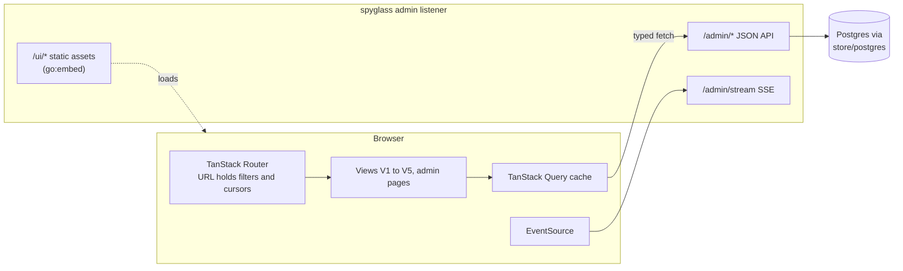

# Front-end architecture (React UI)

Part of the [architecture set](README.md). v1 is an observe-only logging proxy for the Anthropic family; the admin page for providers and pricing is read-only. The JSON API this UI calls is specified in [backend.md](backend.md#admin-and-query-api). How the built UI ships inside the container is in [deployment.md](deployment.md).

## Decision and shape

The captain chose a **React single-page application embedded in the Go binary**, with a Go JSON API and SSE live tail (UI report section 10, Q1 option a).

- Built with Vite and React. No Next.js and no server-side rendering runtime, so the build output is static files that the Go binary embeds with `go:embed`.
- Served by the admin listener under `/ui/`. It talks only to `/admin/*` on the same origin. The admin listener has no sign-in; see [Admin API access](#admin-api-access).
- One binary, one container. Node is needed only at build time. Bifrost, a Go gateway, ships the same packaging with `//go:embed all:ui` and a React UI (UI report 8.2).



## Views

The five views come from the UI report, section 5, in priority order. The overview dashboard at `/ui` is the landing page and links to them ([ADR 0052](../adrs/0052-ui-overview-dashboard-as-landing-page.md)). Its search view (V6) is withdrawn, because bodies are not stored. The UI shows metadata only: numbers, names, ids and hashes. The hierarchy the views share is:

```
session → prompt (user turn) → agent (main or sub-agent) → LLM call → tool call
```

| View | Route | Purpose | Main API calls |
|---|---|---|---|
| Overview (home) | `/ui` | Headline numbers against the previous equal period, activity by model, live feed, recent sessions, problems and cost breakdowns | `GET /admin/usage`, `GET /admin/sessions`, `GET /admin/calls`, `GET /admin/stream`, `GET /admin/config` |
| V1 Call log | `/ui/calls` | Paginated, filterable list of every LLM call, with a volume chart and a summary strip | `GET /admin/calls`, `GET /admin/usage`, `GET /admin/stream` |
| V2 Session list | `/ui/sessions` | One row per session: start, duration, client, key, prompts, calls, tool calls, cost, cache hit, errors, labelled by key, client and start time (no prompt text is stored) | `GET /admin/sessions` |
| V2 Session view | `/ui/sessions/:key` | Tree and waterfall of prompts, agents, calls and tool calls | `GET /admin/sessions/{key}`, `GET /admin/tool-calls?session=` |
| V3 Call detail | `/ui/calls/:id` | Who, timings, usage and cost, outcome, tools requested and resolved. No content | `GET /admin/calls/{id}` |
| V4 Tool-call explorer | `/ui/tools` | Per-tool summary and a list of tool calls with filters on name, error, duration and sizes | `GET /admin/tool-calls/summary`, `GET /admin/tool-calls` |
| V5 Cost and cache | `/ui/cost` | Cost by key, model, client and session; cache hit ratio over time | `GET /admin/usage`, `GET /admin/usage/prompts`, `GET /admin/config` |
| Admin | `/ui/admin/config` | View providers, pricing and key names (with `disabled`), read-only, because they live in the config file and change with `SIGHUP`. No key management: keys are added, disabled and rotated in the config file | `GET /admin/config` |

The wireframes for V1 to V4 are in UI report sections 5.1 to 5.4; the parts that show message text, tool arguments or tool results are dropped. Every page shares one frame in the Linear look of [ADR 0033](../adrs/0033-ui-v2-session-list-and-session-view.md), branded Spyglass with a dark and a light theme ([Look and themes](#look-and-themes)): a sidebar with the Spyglass brand, the main navigation (the current page marked with the accent) and the theme toggle, one type scale, and the same filter menu, time-range picker, badges and empty, loading and error states. Behavior that matters for the architecture:

### Overview (home)

- The landing page at `/ui`, first in the sidebar ([ADR 0052](../adrs/0052-ui-overview-dashboard-as-landing-page.md)). An unknown `/ui/*` path falls back to it.
- A time range of 1h, 24h (default), 7d or 30d, in the URL. No absolute window.
- Headline numbers: calls, cost, tokens in and out, error rate, cache hit ratio, p50 and p95 latency. Each has a sparkline and the change against the previous equal period, shown with a glyph, a sign and words. Over several usage buckets, p50 and p95 are a call-weighted mean of the bucket percentiles, marked "≈", because the usage API has no percentile over a whole range.
- Activity: calls or cost per interval stacked by model, with errors per interval as a line on their own scale.
- Live feed of the latest finished calls (the shared live hook), recent sessions with an error badge, and problems: errors grouped by error class, each linking to the call log filtered to that class.
- Breakdowns: cost ranked by model, client and key, and the top 5 sessions by cost, linking to V5, V1 and V2.
- Unknown cost shows as unknown. Cost through a `client_passthrough` provider (from `GET /admin/config`) carries the "API-equivalent" label.

### V1 Call log

- Columns: time, session and prompt, agent, client, model, status, latency, tokens in and out, cost, number of tool calls requested.
- A row click opens V3. A session cell opens V2.
- The filter menu covers every logged criterion: time, session, prompt, agent, agent type, request class, client, key name, provider, model, endpoint, status, error class, streamed, latency, cost, tool name, tool error. TTFT, tokens and cache hit are columns and chart values, not filters.
- "Group by session" folds consecutive calls of a session into one row with "N turns" (Bifrost pattern), kept in the URL.
- Counts are exact up to 10,000 and show "10,000+" above that (UI report 6.3). A 24-hour window holds at most about 50,000 rows.
- A **Live** toggle prepends new calls from the SSE stream. See [Live tail](#live-tail).
- Look: dense rows with right-aligned numbers (latency, tokens, cost, tool calls), the status as a small badge (an error badge also shows the error class and a glyph, so it does not rely on colour), and model and client as subtle tags. The summary strip and the volume chart use the shared palette. The rows move with the arrow keys or `j` and `k`, and `Enter` opens the focused row, as on the session pages.

### V2 Session view

- **Tree mode** nests prompt, then agent, then call, then tool call. A sub-agent nests under its parent agent, taken from the parent-agent header. The agent tree is computed from the session's call rows when the page loads. Nesting under the exact `Task` tool call that spawned it is a later item ([backend.md](backend.md#storage-and-scale)).
- **Time mode** is a waterfall sorted by start time, with one lane per agent, so parallel sub-agents and parallel tool calls show as concurrent bars.
- **Idle-gap compression** in both modes: gaps wider than 5% of the session collapse to a fixed marker (Langfuse's port of Sentry's approach). Agent sessions are mostly idle time, so a linear axis would hide the work.
- Each tree row shows duration, tokens, cost and an error badge.
- A call without a session header has no session, so it shows in V1 and V3 but in no session row or tree.
- Compaction points (the `context_compacted` flag, from `x-claude-code-context-compacted`) are drawn as a marker where the cache prefix resets.
- Collapsed by default past the latest prompts; virtualized beyond a few hundred rows.
- Design direction ([ADR 0033](../adrs/0033-ui-v2-session-list-and-session-view.md)): the look follows Linear (dense, keyboard-first, monochrome with one accent colour; the palettes are in [Look and themes](#look-and-themes)) and the layout follows Langfuse's session and trace view (the nested tree with per-row numbers beside a waterfall on a shared time axis).

### V3 Call detail

Tabs: Overview, Tools, Usage and cost. All of them show stored numbers, names and hashes. The page never shows what the prompt or the response said.

- A **side panel** beside every tab shows the model, provider, time and upstream request id; who made the call (key, client, session link, agent, sub-agent, prompt id); and tokens in and out, cache read and write, cache hit and cost.
- **Overview** shows a timing bar for time to first byte, TTFT and duration, in the session waterfall's style, and the exchange as a chat-style thread of metadata blocks: a system block when the call is a compaction request or follows a compacted context, the request (prompt id, tokens in), the response (status, error type, stop reason, output and reasoning tokens) and each tool call it asked for. Tool results have no block of their own: each tool call block shows the outcome and result size of its result, from the same pairing as the Tools tab, and reads Pending, No result or unknown when no result is known. A long run of tool call blocks is collapsed behind a button. The provider's error message text is not shown, because it is not stored (resolved decision D12, [ADR 0044](../adrs/0044-provider-error-message-text.md)).
- **Tools** lists each tool requested in this call, beside the call that resolved it, and each tool result this call carries, beside the call that requested it. Each row shows name, call id, argument size, result size, duration, and success or error, and links to the other call. A half that has no pair reads as unknown. There is no argument or result text.

### V4 Tool-call explorer

- Summary table per tool: count, error rate, p50 and p95 duration, total time, split by agent type.
- List: time, session and agent, tool name, argument size, result size, success or error, duration. Duration shows whether it came from the header or was estimated. Argument and result content is not shown (resolved decision D11, [ADR 0043](../adrs/0043-short-tool-snippets.md)).
- Unmatched halves (a use with no result, a result with no use) are their own filter.

### V5 Cost and cache

- In-app: top sessions by cost, cost per prompt, cost per firstmate task (key name `fm:<task-id>`), and the cache hit ratio over time.
- Calls with `auth_mode = client_passthrough` show an "API-equivalent" cost label, because the plan bills the person, not per token.
- Cost per prompt comes from `GET /admin/usage/prompts`, computed over every call of the range ([ADR 0057](../adrs/0057-cost-per-prompt-endpoint.md)). The table lists the most costly prompts only and says when the range has more.
- Usage numbers are computed from raw call rows, so very long ranges (months) can take seconds. Rollup tables and Grafana dashboards over them are later items ([backend.md](backend.md#storage-and-scale)).

## Look and themes

The UI is branded **Spyglass** ([ADR 0053](../adrs/0053-spyglass-brand-palettes-and-theme-switching.md)); the binary and the commands are named `spyglass` too ([ADR 0054](../adrs/0054-rename-to-spyglass.md)). The proposals the brand was chosen from are in [branding-proposals.html](../branding-proposals.html).

- **Brand.** The sidebar shows the Lens and glint icon beside "Spyglass": a brass lens ring and reflection arc with a teal pupil. The page title is Spyglass. `favicon.svg` follows the system colour scheme, and `apple-touch-icon.png` is the dark version.
- **Tokens.** Every colour in `web/src/styles.css` is a custom property: background, surface, hover, active, text, muted, borders, bars, the brass accent, teal (`--ok`) for live and ok states, and error red. The light theme only redefines tokens, so components need no per-theme rules.
- **Colour roles.** Brass is the one accent: the current page, focus rings, links, the first chart series, the volume bars and the call bars in the waterfall. Teal is the second colour: the live dot, the ok badge and the second chart series. "Other" is a neutral grey. Error red is a status colour, and an error always has a glyph and text as well.
- **Switching.** Dark is the default. The UI follows `prefers-color-scheme`, unless the toggle in the sidebar footer forces Light or Dark through `data-theme` on `<html>`. System clears the attribute. The browser remembers the choice in `localStorage` (`spyglass-theme`), and if storage fails the UI falls back to System. `public/theme-init.js` applies the stored choice before first paint. It is a file, not an inline script, because of the CSP.

## Routing and URL state

- **TanStack Router** with typed search parameters. Every filter, the time range, the cursor, the grouping toggle and the active tab are search parameters.
- A filtered view is therefore a shareable link. The firstmate alert adapter and Grafana data links can point at one.
- The router's search-param validation rejects unknown values, so a stale or hand-edited URL degrades to defaults instead of an error.
- The SPA is mounted at `/ui/`. The Go handler returns `index.html` for any `/ui/*` path that is not a file, so deep links and reloads work (see [Build and embedding](#build-and-embedding)).

## State and data fetching

- **Server state** lives in the TanStack Query cache, keyed by endpoint and parameters. There is no separate global store; the URL and the query cache are the state.
- **Typed client:** TypeScript types are generated from the admin API's OpenAPI document (`api/openapi.yaml`, served at `/admin/openapi.json`) with `openapi-typescript`, and requests go through a thin typed `fetch` wrapper. A change to the API that breaks the UI fails the UI's type check in CI.
- **Pagination:** lists use the forward keyset cursor the API returns. There are no page numbers and no "newer" button; the user reloads the first page to see newer calls. Infinite scroll in V1 and V4 uses `useInfiniteQuery` over `next_cursor`.
- **Caching rules:** finished calls never change, so call detail is cached without expiry for the session. List queries refetch on focus and when the live toggle is off.
- **Errors:** API errors carry a stable `type`; the UI maps them to inline messages.

## Table virtualization

- **TanStack Table** for column definitions, sorting of the loaded rows, column visibility and sizing.
- **TanStack Virtual** for row virtualization in V1, V2 (tree rows) and V4. Only visible rows are in the DOM, so a list of thousands of rows or a session of hundreds of calls stays responsive.
- The V2 tree and waterfall follow agent-prism's model (MIT): a flattened, virtualized list of tree rows, each with a waterfall bar on a shared, compressed time axis. Use its components if they fit, or reimplement the pattern.

## Rendering

Every payload is a small JSON object of numbers, names, ids and hashes, so there is no large-body rendering problem and no need for a code or JSON viewer component beyond a plain collapsible block for the usage JSON. Long lists are virtualized as above.

## Live tail

- The V1 **Live** toggle opens an `EventSource` on `/admin/stream` with the same filter parameters as the list.
- `call.finished` events insert the finished call at the top of the list. The stream carries finished calls only, so the UI has no in-flight rows and no spinner.
- The client keeps at most 500 live rows and drops the oldest. Older rows remain reachable through the paginated list.
- **On reconnect the UI refetches the first page of the list** (TanStack Query does this when the stream reopens) and de-duplicates live rows by call id. The server does not replay missed events, because the call id orders calls by start time, not finish time ([backend.md](backend.md#live-tail)).
- The stream is one-way, so SSE is enough; no WebSocket.
- v1 runs one replica, so the stream carries every call. The multi-replica live tail is a later item ([backend.md](backend.md#storage-and-scale), [deployment.md](deployment.md#later-multi-replica-tier)).

## Admin API access

- The admin plane has no sign-in in v1. The admin listener binds to a loopback address and `serve` refuses to start otherwise ([backend.md](backend.md#shape)), so the UI and the API are open to whoever can reach that interface. There is no sign-in page, no session cookie and no admin token. Scripts and the firstmate adapter call the API without a credential.
- Virtual keys work only on the data plane and are configured in the config file, not in the UI.
- Every v1 admin endpoint is a read-only `GET`. The API sends no CORS headers, so other web pages cannot read it from a browser.
- Admin sign-in, scopes, several admins and OIDC are later items ([backend.md](backend.md#gateway-features-decision-c1)).
- **Content Security Policy** on `/ui/*`: `default-src 'self'`, no inline scripts, no third-party origins. Stored strings (tool names, model names, labels) are rendered as text, never as HTML, so a value that contains markup cannot run in the browser.

## What the UI can show without bodies

**Decision D1 is resolved: bodies are never stored** ([README](README.md#resolved-decisions)). The UI is built on that, with no per-key variants.

| View | What it shows |
|---|---|
| V1 Call log | Every call with its metadata and filters. No text filter |
| V2 Session view | Prompts (by id), agents, calls, tool calls |
| V3 Call detail | Overview, tools, usage and cost. No conversation, no raw tab, no headers |
| V4 Tool explorer | Names, counts, error rates, durations, sizes. No arguments or results |
| V5 Cost and cache | Cost and cache views |

Search is withdrawn. Older calls stay browsable by filters. Where a reader might expect content, the UI states "Content is not stored" once, instead of showing empty panels.

## Build and embedding

```
web/                          React + Vite source
├── src/
│   ├── router.tsx            route tree (code-based) and per-route search validators from search/
│   ├── routes/               one component per route
│   ├── search/               search-parameter validators: time range, filters, tabs
│   ├── views/                V1 to V5 and admin pages
│   ├── components/           layout, table, time-range and filter primitives; tree, waterfall
│   ├── api/                  generated types (schema.gen.ts, `make ui-gen`), typed client, query keys
│   ├── lib/                  formatters (null shows unknown, not zero), theme choice
│   └── main.tsx
├── public/                   copied as is: favicon.svg, apple-touch-icon.png, theme-init.js (pre-paint theme)
├── index.html
├── package.json              pinned versions, lockfile committed
└── vite.config.ts            base: '/ui/', dev proxy for /admin to :9090
internal/ui/
├── dist/                     build output, copied here by the build; not committed
└── embed.go                  //go:embed all:dist; SPA handler
```

Build steps:

1. `npm ci && npm run build` in `web/` produces `web/dist/` with content-hashed asset names.
2. The build copies `web/dist/` to `internal/ui/dist/`.
3. `go build` embeds it through `//go:embed all:dist` in `internal/ui`.

The container build runs these in a multi-stage Dockerfile ([deployment.md](deployment.md#container-image)), so Node never reaches the runtime image.

Serving rules in `internal/ui`:

- Files under `/ui/assets/` are served with `Cache-Control: public, max-age=31536000, immutable`, because their names carry a content hash.
- `index.html` is served with `Cache-Control: no-cache`, so a new release is picked up on the next load.
- Other files at the root of the build (the favicon, the touch icon and `theme-init.js`) are served with `Cache-Control: no-cache`.
- Any other `/ui/*` path that is not a file returns `index.html` (client-side routing).
- A build tag `noui` replaces the embed with a stub page, for Go-only development and tests without Node.

Development: run `spyglass serve` locally and `npm run dev` in `web/`. Vite serves the UI with hot reload and proxies `/admin/*` to `localhost:9090`.

Dependency upkeep: npm dependencies are pinned with a committed lockfile and updated by a Dependabot-style routine. This is the main maintenance cost of choosing React over Go plus htmx (UI report 8.2).

## Schema and API gaps this UI depends on

From UI report section 9. Each is resolved in [backend.md](backend.md#data-model) or the API table there.

| Gap | Needed by | Resolution |
|---|---|---|
| G1 correlation columns, text session key | V1 to V4 | `calls` has agent, prompt, request class and compaction columns and `session_key text` |
| G2 `agents` entity and spawn link | V2 tree | No table: the agent tree is computed from the session's call rows. The `Task` spawn link is deferred |
| G3 session endpoints | V2 | `GET /admin/sessions`, `…/{key}`, `GET /admin/tool-calls?session=`, all computed from call rows |
| G4 body and conversation endpoints | V3 | Withdrawn: no bodies are stored |
| G5 random access into the journal | V3 | Withdrawn: there is no journal |
| G6 `tool_calls` display and filter columns | V4, V1 tool filter | `tool_events` rows (sizes, `is_error`, source) paired at read time; duration from the header or estimated |
| G7 rollup dimensions | V1 summary, V5 | Deferred: `GET /admin/usage` aggregates raw rows |
| G8 `(ts, id)` index | V1 keyset | `calls (ts DESC, id DESC)` |
| G9 error partial index | V1 errors filter | `calls (ts DESC) WHERE error_class IS NOT NULL` |
| G10 searchable text | V6 | Withdrawn: no text is stored |
| G11 MCP calls | V4 | Deferred with the MCP gateway (`source = 'mcp'`) |
| G12 bodies off by default | V3, V4 | Resolved by D1: bodies are never stored |
| G13 live event feed | V1 live tail | In-process fan-out in `recorder` and `GET /admin/stream` |

## Deferred

Saved views, annotations and scores, editing pricing in the UI, admin sign-in, admin roles, OIDC sign-in, static HTML export of a session, backward paging, a cache-miss view (cache strip, Cache tab in call detail, misses with cause; deferred with cache-miss diagnosis, see [backend.md](backend.md#cache-miss-diagnosis)), and an OTel export to an external trace viewer such as Phoenix (UI report 8.5). Triggers for the backend items are in [backend.md](backend.md#later-versions).
