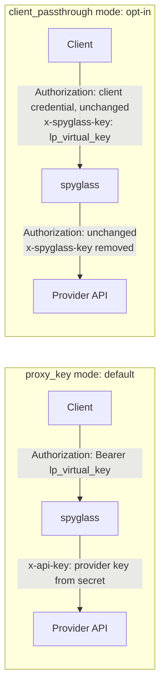

# Upstream connection

Part of the [architecture set](README.md). v1 serves the Anthropic family only; the OpenAI family is a v2 item, collected under [Later: OpenAI family (v2)](#later-openai-family-v2). This document covers how the proxy reaches provider APIs, how clients are pointed at the proxy, and what Anthropic documents about routing a Claude subscription through a gateway. The proxy internals it refers to (`Rewrite`, the extractor) are in [backend.md](backend.md).

Sources were fetched on 2026-10-20 and are listed at the [end](#sources). Statements about Anthropic's behavior and terms quote or paraphrase those pages; nothing here describes an auth flow those pages do not document.

## Protocol family and endpoints

**Resolved decisions D3 and C4** ([README](README.md#resolved-decisions)): v1 is a passthrough for the Anthropic family only. An Anthropic-format request goes to an Anthropic-format upstream, and the proxy never translates between formats. The OpenAI family moves to v2 ([below](#later-openai-family-v2)).

| Family | Client-facing endpoints on the data plane | Upstream kinds |
|---|---|---|
| Anthropic Messages | `POST /v1/messages`, `POST /v1/messages/count_tokens`, `GET /v1/models`, `HEAD /api/hello` | `anthropic` (the Claude API at `api.anthropic.com`) |

Notes from Anthropic's gateway compatibility guide:

- Claude Code posts inference to `/v1/messages?beta=true`, so the proxy matches on the path, not the full URL.
- `count_tokens` is optional. Without it, Claude Code falls back to a character-based estimate. The proxy forwards it upstream.
- `HEAD /api/hello` is a connection-warming probe that a gateway may reject without breaking anything. The proxy answers it locally with `200` and does not log it as a call.
- `GET /v1/models` is used for model discovery only when the client sets `CLAUDE_CODE_ENABLE_GATEWAY_MODEL_DISCOVERY=1`. In v1 the proxy forwards it upstream, so the `/model` picker shows the upstream's models. The endpoint must answer directly at the base URL, without redirects, within 3 seconds.

Out of scope for v1: cloud-provider formats (Amazon Bedrock InvokeModel, Google Cloud's Agent Platform rawPredict, Microsoft Foundry, Claude Platform on AWS). They need request signing or a different wire format, which falls under the translation decision (gap review B8, B2).

## Provider configuration

Providers are declared in the config file (**resolved decision D7**). Credentials are referenced, never inlined:

```yaml
providers:
  - name: anthropic
    kind: anthropic
    base_url: https://api.anthropic.com
    auth_mode: proxy_key              # proxy_key | client_passthrough, one per provider
    credential:
      file: /run/secrets/anthropic_api_key
    idle_timeout: 120s                # idle-between-chunks watchdog
```

- `credential` resolves to an env var or a file. It is read at start and on `SIGHUP`. No API returns it, it is redacted from every log, and no call record holds it.
- Pricing is in the same file ([deployment.md](deployment.md#configuration)). The model name in a request is forwarded as sent.
- Per-provider timeouts other than `idle_timeout` are not configurable in v1. Every provider gets the same fixed dial and time-to-headers timeouts ([backend.md](backend.md#proxy-passthrough-and-streaming)).
- One provider may later hold a pool of keys to spread upstream rate limits (gap review B8). v1 has one key per provider.

## Credential modes

The proxy has two ways to authenticate upstream. Each provider has one fixed `auth_mode`: `proxy_key` or `client_passthrough`. There is no mode that accepts both on one provider. The call record stores the mode used for the request, under the same two names.



| | `proxy_key` (default) | `client_passthrough` (opt-in) |
|---|---|---|
| Client credential | A virtual key, in `Authorization: Bearer` or `x-api-key` | The client's own provider credential, untouched |
| How the proxy identifies the client | The virtual key | A virtual key in the `x-spyglass-key` header, required |
| Upstream credential | The provider key held by the proxy | The client's credential, forwarded unchanged |
| Who is billed | The owner of the proxy's provider key | The owner of the client's credential |
| Cost | Computed from pricing; the owner of the provider key pays | Computed as an API-equivalent figure for analysis; the plan bills the person |
| Main use | API-key access for every harness | A person routing their own Claude subscription through their own proxy |

In both modes the proxy requires a virtual key. Without one, the proxy would be an open relay for anyone's credentials, and calls could not be attributed. A presented `lp_` key is never forwarded upstream.

A request that carries a credential in the wrong place for the provider's mode is rejected with `401`, so a virtual key cannot leak upstream by accident. For a `client_passthrough` provider that means an `lp_` value in `Authorization` or `x-api-key`. For a `proxy_key` provider it means an `x-spyglass-key` header.

## Header handling

For the Anthropic family. "Forward" means unchanged, byte for byte.

| Header | Request handling |
|---|---|
| `Authorization`, `x-api-key` | `proxy_key`: consumed as the virtual key, removed, and replaced by `x-api-key: <provider key>`. `client_passthrough`: forwarded, never logged, never stored; a value that starts with `lp_` is rejected with `401` |
| `x-spyglass-key` | `client_passthrough`: consumed as the virtual key, never forwarded. `proxy_key`: rejected with `401` |
| `x-llm-proxy-key` | The deprecated name of `x-spyglass-key` from release 0.1.0, handled the same way until 0.4.0. When both are sent, `x-spyglass-key` is used and both are removed. The first request that uses it logs one warning per process, without the key ([ADR 0054](../adrs/0054-rename-to-spyglass.md)) |
| `anthropic-version`, `anthropic-beta`, every other `anthropic-*` | Forwarded. Treated as open lists, never allowlisted, as Anthropic's guide requires |
| `x-claude-code-*` | Read for correlation ([backend.md](backend.md#correlation)) and forwarded |
| `traceparent` | Recorded and forwarded |
| `Accept-Encoding` | Not forwarded. The proxy sends `identity` upstream whatever the client sent, so the tap can scan the body ([ADR 0050](../adrs/0050-upstream-identity-encoding.md)) |
| Hop-by-hop headers | Removed by `ReverseProxy`, as HTTP requires |

| Header | Response handling |
|---|---|
| `content-type` | Forwarded; `text/event-stream` on streams |
| `retry-after` | Forwarded from the upstream; integer seconds when the proxy generates the error |
| `x-should-retry` | Forwarded |
| `anthropic-ratelimit-unified-*` | Forwarded on every response. Claude Code reads them to show plan usage to subscription users and to tell a plan limit from a temporary throttle |
| `request-id` | Forwarded and stored as `upstream_request_id` |
| `x-request-id` | Added: the proxy's call id |

Body handling follows Anthropic's "inspect without modifying" rule. The proxy forwards the `system` array, `tools`, earlier `messages`, `cache_control` markers and error bodies unchanged. Rewriting any of them breaks the system-prompt attribution strip, prompt caching, or the preserved-thinking check, which then fails with `bound to a different conversation`. The proxy makes no body edit.

## Claude Code with a proxy-held API key

This is the default, documented gateway setup. Anthropic's "Other LLM gateways" page lists what it gives: provider keys stay server-side, usage is attributed per developer, and audit logs live in one place.

Client configuration, in the shell or in the `env` block of `~/.claude/settings.json`:

```json
{
  "env": {
    "ANTHROPIC_BASE_URL": "https://spyglass.internal:8080",
    "ANTHROPIC_AUTH_TOKEN": "lp_…",
    "CLAUDE_CODE_GATEWAY_HINT_HEADERS": "1"
  }
}
```

- `ANTHROPIC_AUTH_TOKEN` sends the virtual key as `Authorization: Bearer`. `ANTHROPIC_API_KEY` would send it as `x-api-key`, and an `apiKeyHelper` sends it in both. The proxy accepts all three.
- `CLAUDE_CODE_GATEWAY_HINT_HEADERS=1` turns on the hint headers that the session tree and tool durations use. They are off by default behind a custom base URL. Firstmate crewmates set it (resolved decision D5, [ADR 0042](../adrs/0042-claude-code-hint-headers-for-crewmates.md)).
- The documentation warns against putting the credential in a project's committed `.claude/settings.json`.
- Billing: "While a gateway credential variable or `apiKeyHelper` is active, requests carry that credential in place of a developer's claude.ai subscription login, and the subscription's usage limits don't apply to them." The traffic is billed per token to the owner of the key the proxy forwards, for example an Anthropic Console account.
- A saved claude.ai login stays on the machine but is not sent while the gateway credential is set. `/status` in Claude Code shows which credential is active.
- Virtual keys come from the proxy's config file, not from the UI: the operator generates one (`spyglass keygen --name <name>`, see [deployment.md](deployment.md#secrets)), adds its name and hash to `keys:`, sends `SIGHUP`, and gives the plaintext to the client. The key's name is what the call log shows.
- For firstmate, each crewmate gets its own virtual key named `fm:<task-id>` (gap review N7). The v1 firstmate route is `proxy_key` with a Console API key held by the proxy. The operator issues the keys by hand: one config entry per key and a `SIGHUP`. Names must stay stable, because history is grouped by name. Injecting a key into each crewmate at launch is a later item ([backend.md, Later versions](backend.md#storage-and-scale)). `client_passthrough` stays for one person's own interactive Claude Code.

Optional client settings that help behind a proxy:

| Variable | Effect |
|---|---|
| `CLAUDE_CODE_ENABLE_GATEWAY_MODEL_DISCOVERY=1` | Claude Code adds the `/v1/models` list it receives to its `/model` picker. In v1 that is the upstream's list |
| `CLAUDE_CODE_DISABLE_NONESSENTIAL_TRAFFIC=1` | Stops version checks, telemetry and similar traffic that goes outside the proxy. It also disables auto-updates |
| `ANTHROPIC_CUSTOM_HEADERS` | Adds headers, one `Name: Value` pair per line; used for `x-spyglass-key` in passthrough mode |

Known traffic that never passes through the proxy, per Anthropic's docs: the fast-mode availability check and the WebFetch domain safety check call `api.anthropic.com` directly, and telemetry goes to Anthropic without the gateway credential. The proxy cannot log these.

## Claude Code with a Claude subscription

**Resolved decision D6** ([README](README.md#resolved-decisions)): the proxy supports this as an opt-in `client_passthrough` mode, off by default per provider. It is documented as the **personal local setup**: one person routes their own Claude login through their own proxy on `127.0.0.1`. It is not for shared or heavy use; for that, use `proxy_key` with an API key ([above](#claude-code-with-a-proxy-held-api-key)). The rules below apply.

### What Anthropic documents

The "Other LLM gateways" page describes this case directly:

> "`ANTHROPIC_BASE_URL` is the variable that points Claude Code at the gateway. Setting only that variable, without a gateway credential, doesn't replace the subscription. Requests still route through the gateway, but a saved claude.ai login remains the active credential, so its usage limits and billing apply. Gateways that pass this traffic on to Anthropic must forward the OAuth capability in `anthropic-beta`."

The gateway compatibility guide adds, for the `anthropic-beta` header:

> "When the developer authenticates with a claude.ai login, which is possible when `ANTHROPIC_BASE_URL` is set without a gateway credential variable, this header also carries an OAuth capability that the upstream requires, and stripping it fails those requests with `401`."

So a documented, working setup exists: Claude Code signed in with a Pro or Max account through Anthropic's own login flow, `ANTHROPIC_BASE_URL` pointed at the proxy, no gateway credential variable, and the proxy forwarding `Authorization` and `anthropic-beta` unchanged to `api.anthropic.com`.

### Client configuration

Personal local setup, in `~/.claude/settings.json` or the shell:

```json
{
  "env": {
    "ANTHROPIC_BASE_URL": "http://127.0.0.1:8080",
    "ANTHROPIC_CUSTOM_HEADERS": "x-spyglass-key: lp_…",
    "CLAUDE_CODE_GATEWAY_HINT_HEADERS": "1"
  }
}
```

- Do not set `ANTHROPIC_AUTH_TOKEN`, `ANTHROPIC_API_KEY` or `apiKeyHelper`. Any of them takes precedence over the saved login.
- The proxy listens on `127.0.0.1` only, and its provider uses `auth_mode: client_passthrough`; the matching config is a worked example in [deployment.md](deployment.md#personal-local-setup-subscription-passthrough).
- Sign in with `/login` in Claude Code, as usual. The sign-in completes through Anthropic's flow. The proxy takes no part in it.
- The virtual key is an entry in the proxy's `keys` section (name and SHA-256; see [deployment.md](deployment.md#secrets)). It travels in `x-spyglass-key` through `ANTHROPIC_CUSTOM_HEADERS`, which Claude Code adds to its requests. Anthropic's docs list custom routing headers among the values that can need approval, with extra rules when they come from a project settings file, so set them in `~/.claude/settings.json` or the shell.

### Terms that apply

From Anthropic's Claude Code "Legal and compliance" page:

- Free, Pro and Max use is governed by the Consumer Terms of Service; Team, Enterprise and Claude API use by the Commercial Terms of Service.
- "OAuth authentication is intended exclusively for purchasers of Claude Free, Pro, Max, Team, and Enterprise subscription plans and is designed to support ordinary use of Claude Code and other native Anthropic applications."
- "Anthropic does not permit third-party developers to offer Claude.ai login into their own applications, or to route requests through Free, Pro, or Max plan credentials on behalf of their users. Moreover, developers may not collect, store, or intermediate Claude.ai credentials or session tokens — sign-in to a Claude account must complete through Anthropic's own flow."
- The same page does not prevent "an end user from signing in to the unmodified Claude Code binary with their own Claude subscription".
- "Advertised usage limits for Pro and Max plans assume ordinary, individual usage of Claude Code and the Agent SDK."
- "Anthropic reserves the right to take measures to enforce these restrictions and may do so without prior notice."

### What the proxy must and must not do in passthrough mode

Read together, the documented gateway behavior and the terms give these rules. They are the design constraints for `client_passthrough`, not legal advice. Where the terms are not explicit about a self-hosted logging proxy, the design takes the conservative reading.

The proxy **must**:

- forward the client's `Authorization` header and the full `anthropic-beta` header unchanged, or requests fail with `401`;
- send passthrough traffic only to `api.anthropic.com`, the provider the credential belongs to;
- forward `anthropic-ratelimit-unified-*` response headers, so Claude Code can show plan usage and limits;
- carry only the traffic of the person whose login it is: one subscription login per virtual key, issued to that person.

The proxy **must not**:

- store the OAuth token anywhere: not in the store, not in logs, not as a hash. The call record holds `auth_mode = client_passthrough` and nothing else about the credential ([backend.md](backend.md#extractor));
- hold a subscription token of its own, or inject one into requests;
- offer a sign-in flow, or capture a token from one;
- share one person's subscription among several people or agents of other people, or present it as a team service;
- rewrite the model to another provider or fall back to a proxy-held key. Anthropic also states that it "doesn't support routing Claude Code to non-Claude models through any gateway".

### Technical limits in this mode

- **Usage limits.** The subscription's limits apply. A fleet of parallel Claude Code sessions on one Max login consumes them fast, and the terms assume ordinary, individual use.
- **No billed cost.** Calls are billed by plan, not per token. The proxy still computes an API-equivalent cost for analysis. The UI shows the "API-equivalent" cost label when `auth_mode = client_passthrough`. v1 enforces no budget or rate limit in any mode.
- **Features tied to the claude.ai identity:** Remote Control is disabled while `ANTHROPIC_BASE_URL` points at a non-Anthropic host, even with a claude.ai login.
- **Compliance:** sessions that go through a gateway are not eligible for Anthropic's HIPAA configuration.
- **Team or multi-user deployments** should use `proxy_key` mode with an organization API key under the Commercial Terms. Anthropic's rollout guidance issues each developer a gateway credential and gives the gateway the provider credential. Passthrough in a shared deployment is acceptable only when every request carries the requester's own login, which the proxy cannot verify. The default configuration therefore disables passthrough.

### Alternative from Anthropic

Anthropic also ships the [Claude apps gateway](https://code.claude.com/docs/en/claude-apps-gateway), a self-hosted gateway with SSO sign-in and OTLP telemetry. It is not adopted here because it is a separate product with its own protocol (`GET /protocol`), and the goal of this project is its own complete call and tool-call log.

## Later: OpenAI family (v2)

Decision C4: v1 supports the Anthropic family only. This section records the OpenAI-family design for v2; nothing here ships in v1. Backend items for v2 are in [backend.md](backend.md#openai-family-v2-decisions-c4-and-d3).

**Scope.** Same-family passthrough: an OpenAI-format request goes to an OpenAI-compatible upstream. No translation between families.

| Family | Client-facing endpoints on the data plane | Upstream kinds |
|---|---|---|
| OpenAI-compatible | `POST /v1/chat/completions`, `POST /v1/responses`, `GET /v1/models` | `openai_compatible` (OpenAI, and local backends such as vLLM or Ollama that expose the same API) |

**Provider configuration.**

```yaml
providers:
  - name: openai
    kind: openai_compatible
    base_url: https://api.openai.com
    auth_mode: proxy_key
    credential:
      env: OPENAI_API_KEY
    headers_to_add: {}                # for example OpenAI-Project, if needed

  - name: local-vllm
    kind: openai_compatible
    base_url: http://vllm.internal:8000
    auth_mode: proxy_key
    credential: none
```

- Local backends are upstreams, not clients: an `openai_compatible` provider with `credential: none`. They often omit cache-token usage fields. Cost and the cache hit ratio degrade on them, and the UI shows those values as unknown, not zero (gap review N5).
- Header handling is the same as for the Anthropic family, with `Authorization: Bearer` as the upstream credential header.

**`include_usage`.** Chat-completions streaming clients that do not ask for usage get none in the stream. The proxy can inject `stream_options.include_usage=true` and strip the extra usage chunk from the client stream. Codex uses the Responses API, which reports usage in its final event, so plain passthrough already logs it. Without injection, a chat-completions client is logged without tokens or cost, flagged `usage_estimated`.

**Clients.**

- **Codex CLI.** OpenAI's Codex configuration docs describe two ways to use a proxy: set `openai_base_url` in `~/.codex/config.toml` for the built-in OpenAI provider, or define a custom provider under `[model_providers.<id>]` with `base_url` and `env_key` (the environment variable holding the key), then select it with `model_provider = "<id>"`. Project-local `.codex/config.toml` ignores these keys. The virtual key goes in the variable `env_key` names.
- **OpenCode** and other OpenAI-compatible tools point their base URL at the proxy and use a virtual key as the API key.
- **Session headers.** Codex and OpenCode session header names are known only from Bifrost's source. Each harness needs a capture test before the session view relies on them (decision D4).
- **ChatGPT sign-in.** OpenAI's docs mention a separate guide for signing in with ChatGPT through a gateway. These documents did not verify it, so ChatGPT-plan passthrough is out of scope.

## Sources

Fetched 2026-10-20:

- Anthropic, Claude Code docs, "Other LLM gateways" (subscriptions and gateways): https://code.claude.com/docs/en/llm-gateway
- Anthropic, Claude Code docs, "Claude Code gateway compatibility guide" (endpoints, request and response headers, hint headers, feature pass-through, model discovery): https://code.claude.com/docs/en/llm-gateway-protocol
- Anthropic, Claude Code docs, "Connect Claude Code to an LLM gateway" (credential variables, precedence over a saved login, nonessential traffic, Remote Control): https://code.claude.com/docs/en/llm-gateway-connect
- Anthropic, Claude Code docs, "Legal and compliance" (terms by plan, authentication and credential use, usage limits): https://code.claude.com/docs/en/legal-and-compliance
- Anthropic, Consumer Terms of Service: https://www.anthropic.com/legal/consumer-terms
- Anthropic, Commercial Terms of Service: https://www.anthropic.com/legal/commercial-terms
- OpenAI, Codex advanced configuration (`openai_base_url`, `model_providers`), used only by the v2 section: https://learn.chatgpt.com/docs/config-file/config-advanced
